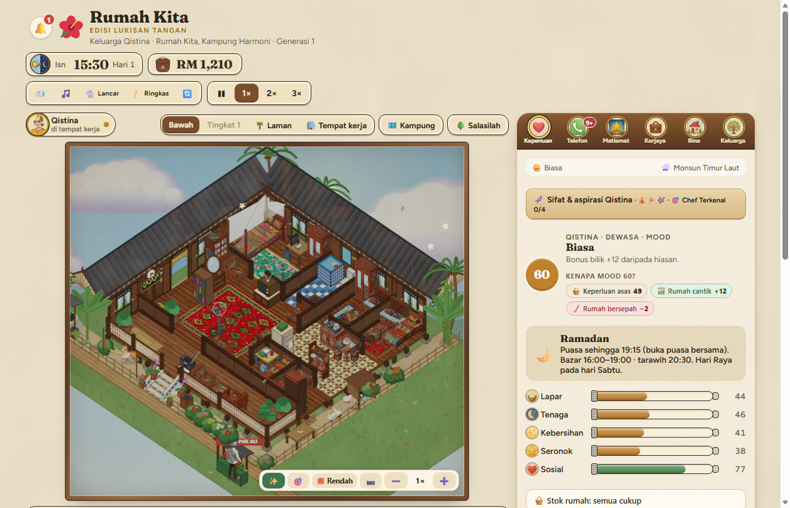

# Rumah Kita

Rumah Kita is a Malaysian family-life simulation. Manage a household, its needs and goals, explore community activities, and build a home.



## Run locally

From this directory, start a local web server:

```sh
python -m http.server 8000
```

Then open `http://localhost:8000/`. Game saves are kept in the browser on this device.
