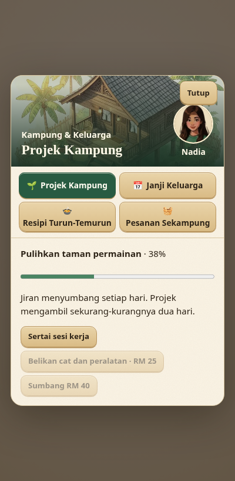

# Panduan Kampung & Keluarga

Dalam permainan, buka **Keperluan → Kampung & Keluarga → Aktiviti**. Kesemua tiga belas permainan kecil ada di sini. Kad menyatakan bila anda boleh mula, sambung atau lihat hasil. Buka **Lihat projek**, **Pilih resipi** atau **Lihat pesanan** jika aktiviti masih memerlukan persediaan.

## Projek Kampung

Pilih projek di Balai Raya. Sertai sesi kerja, belikan bekalan atau sumbang wang. Projek mengambil sekurang-kurangnya dua hari permainan.

Untuk projek taman permainan, pilih **Cat Pagar Padang**. Pilih warna dan ketik atau leret merentasi lapan papan. Anda boleh tutup panel dan sambung kemudian. Apabila semua papan siap, projek yang masih berjalan menerima 25 mata kemajuan. Warna pagar dipaparkan pada kad **Padang** selepas taman dibuka.

Pilih **Baiki Buaian**, pilih tempat duduk, pasang kedua-dua tali dan uji buaian. Menyiapkan buaian menyumbang 25 mata pada projek yang masih berjalan. Selepas taman dibuka, pilih **Main buaian** untuk menghantar Teman ke padang.

Pilih **Pasang Bangku Rehat**. Padankan kaki serong ke kiri dan kaki tegak ke kanan, pasang papan, kemudian pilih tempat teduh. Selepas taman dibuka, pilih **Duduk dan bersembang** untuk menghantar Teman berehat di padang.

Untuk projek kebun, buka **Tanam Kebun Komuniti**. Pilih benih cili, serai atau pandan, kemudian tanam dan siram. Siraman pertama bagi setiap petak menyumbang 8 mata jika projek masih berjalan. Petik tanaman dua hari selepas disiram, apabila kebun dibuka, untuk menambah bekalan memasak.

Buka **Hias Balai Raya** melalui **Projek Kampung** atau **Pesanan Sekampung**. Pilih susunan meja, warna bendera dan tempat pasu, kemudian tekan **Siapkan balai**. Susunan siap dipaparkan pada kad Balai Raya dan dalam pesanan kenduri yang aktif.

**Papan Projek Balai Raya** menunjukkan kerja yang sedang dibuat, pembaikan yang sudah siap dan Teman yang membantu. Buka papan melalui projek taman permainan. Pilih **Baiki Gelongsor** untuk memasang anak tangga, mengetatkan skru dan menguji dengan bola. Dalam **Bersihkan Kotak Pasir**, asingkan barang dan ratakan pasir. Untuk **Tanam Pokok Teduh**, tanam di tepi bangku, siram dan beri dua hari permainan untuk pokok membesar. Selepas taman dibuka dan buaian, bangku serta gelongsor siap, cuba ketiga-tiganya melalui **Uji Taman Bersama Jiran** untuk menyimpan kenangan dalam Buku Warisan.

## Janji Keluarga

Pilih aktiviti, hari, jam dan ahli keluarga. Semak pertindihan jadual kerja atau sekolah sebelum menekan **Buat janji**.

Buka **Cari Masa Bersama** untuk bandingkan waktu dalam tiga hari terdekat. Ketik satu waktu dan lihat potret Teman yang lapang atau ada jadual lain. Waktu yang dipilih mengisi borang. Tekan **Buat janji** untuk menyimpannya dalam **Minggu Ini**.

## Resipi Turun-Temurun

Pilih Teman yang ingin belajar, pilih ahli keluarga dewasa sebagai guru dan minta diajar. Dalam **Masak Bersama Guru**, ikut petua untuk memasukkan bahan dan kacau. Pilih **Masak di dapur** untuk memulakan tugasan memasak. Selepas hidangan siap, catatan resipi muncul dalam **Buku Warisan Keluarga**.

## Pesanan Sekampung

Terima pesanan di Balai Raya, kemudian pilih **Bungkus Bekalan Kenduri**. Padankan bekalan dengan bekas, semak dan sahkan. Sediakan stok dan hantar kuih, buah dan hantaran melalui buku tempahan masing-masing. Siapkan ketiga-tiganya sebelum tarikh tutup untuk mendapat bonus RM60.

## Jejak Kenangan Atuk

Buka **Jejak Kenangan Atuk** melalui **Projek Kampung** atau **Buku Warisan Keluarga**. Baca petunjuk, pilih **Cari tempat di peta**, dan tekan **Periksa lokasi** pada kad tempat yang anda rasa sepadan. Padankan gambar album selepas menemui lokasi. Ketiga-tiga cerita disimpan dalam Buku Warisan, dan jejak boleh disambung kemudian.
