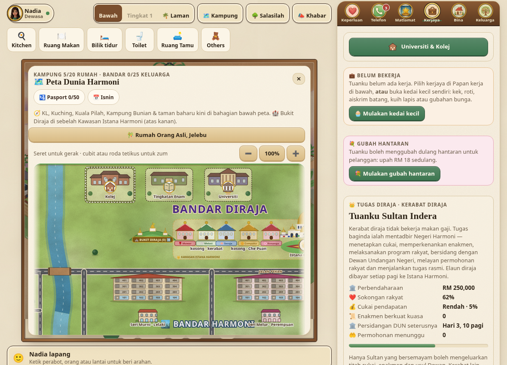
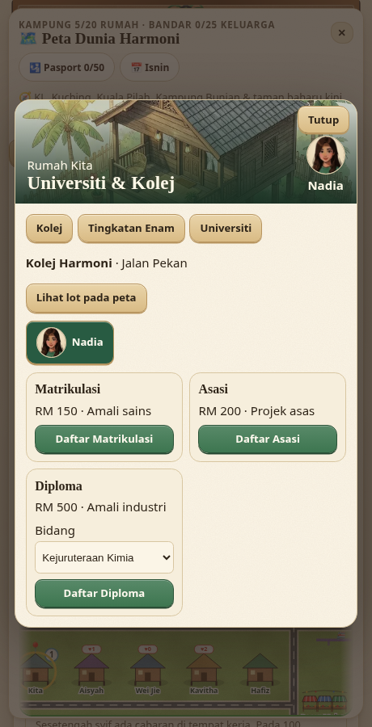
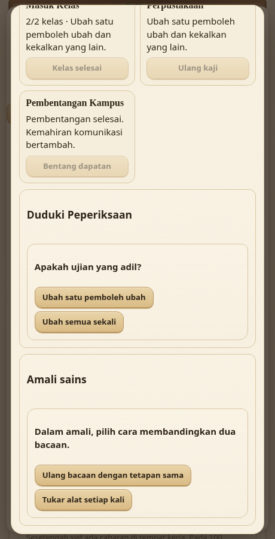
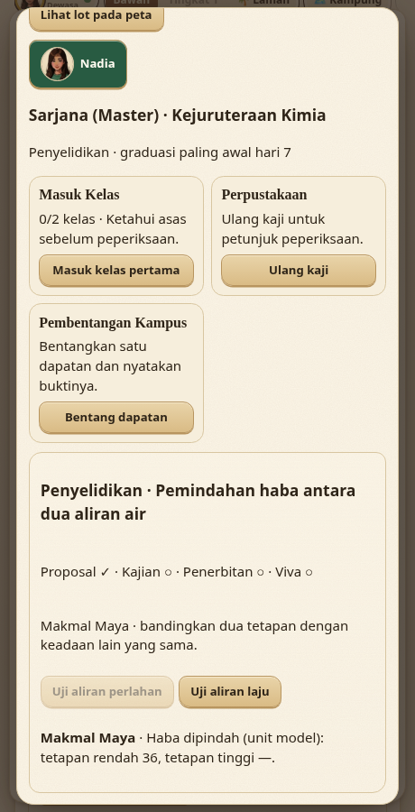

# Panduan Universiti & Kolej

Buka **Kerjaya → Universiti & Kolej**, atau pilih lot pendidikan di peta **Jalan Pekan** dan tekan **Daftar dan belajar**.

## Lot pendidikan di peta

Ikon SVG membezakan Kolej, Tingkatan Enam dan Universiti. Pilih ikon untuk membuka kad lot.

- **Kolej Harmoni** menawarkan Matrikulasi, Asasi dan Diploma.
- **Pusat Tingkatan Enam Harmoni** menawarkan STPM.
- **Universiti Teknologi Harmoni** menawarkan Ijazah Sarjana Muda, Sarjana dan PhD.

## Panel kolej

Pilih Teman dan lihat yuran serta aktiviti sebelum mendaftar.

## Kelas dan peperiksaan

Hadiri kelas, ulang kaji di perpustakaan, dan cuba pembentangan. Peperiksaan terbuka selepas dua kelas. Setiap laluan mempunyai tugasan sendiri, seperti amali, projek atau esei.

## Penyelidikan Kejuruteraan Kimia

Sarjana dan PhD menawarkan **Kerja Kursus**, **Mod Campuran** serta **Penyelidikan**. Dalam laluan penyelidikan, pertahankan proposal, bandingkan dua ujian dalam Makmal Maya atau Simulasi Perisian, kemudian hantar manuskrip. Selepas semakan penilai dan penerimaan paper, jawab soalan viva.

Nama jurnal dan proses pengindeksan Scopus atau Web of Science ialah simulasi dalam permainan.

